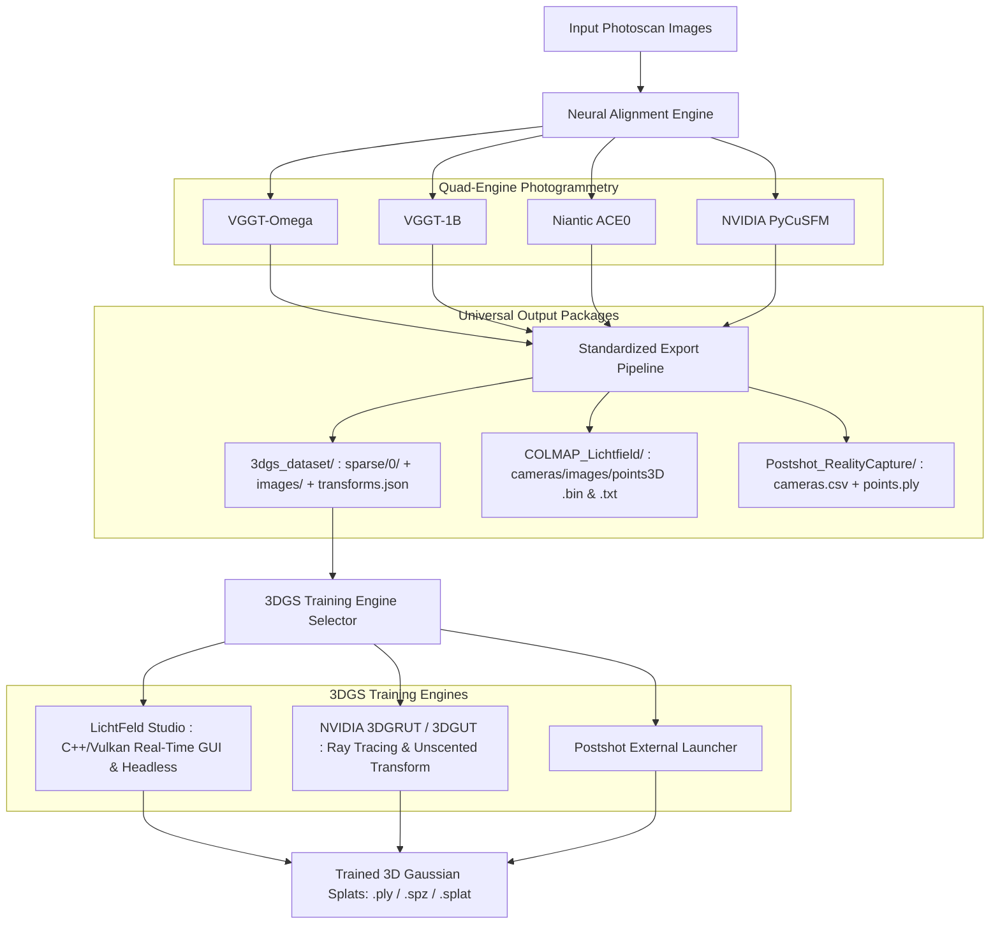

# Implementation Plan: Abu Align & Train (v0.0.2.0)
## Unified Neural Photogrammetry & 3D Gaussian Splatting Training Suite

This plan details the major architectural transition from **Abu Align** to **Abu Align & Train (v0.0.2.0)**. It introduces native 3D Gaussian Splatting (3DGS) training directly into the software with two premier training engines: **LichtFeld Studio** and **NVIDIA 3DGRUT / 3DGUT**, establishes a universal 3DGS dataset export structure, and addresses the native training workflows for **VGGT-Omega** and **ACE0**.

---

## 1. Research Findings & Answers to User Questions

### A. Default 3DGS Training from VGGT-Omega Results
- **Official Method in VGGT / VGGT-Omega Repository:**
  - Meta AI’s official VGGT repository explicitly provides `demo_colmap.py` to export camera intrinsics, camera extrinsics, and triangulated 3D tie points directly into **COLMAP format** (`cameras.bin`, `images.bin`, `points3D.bin`).
  - The repository's official documentation states:
    > *"The exported COLMAP files can be directly used with `gsplat` for Gaussian Splatting training... An example command to train the model is: `python examples/simple_trainer.py default --data_factor 1 --data_dir /YOUR/SCENE_DIR/ --result_dir /YOUR/RESULT_DIR/`"*
  - All modern 3DGS engines (LichtFeld Studio, NVIDIA 3DGRUT, gsplat, nerfstudio `splatfacto`, Postshot) expect a standardized layout:
    ```
    SCENE_DIR/
    ├── images/              (raw or downsampled image collection)
    └── sparse/
        └── 0/               (cameras.bin/txt, images.bin/txt, points3D.bin/txt)
    ```
  - **Solution in Abu Align & Train:** Every alignment run (VGGT-Omega, VGGT-1B, ACE0, PyCuSFM) will now automatically construct a standardized `3dgs_dataset/` folder containing this exact `sparse/0/` and `images/` directory structure plus `transforms.json`, allowing any 3DGS engine to ingest it instantly.

---

### B. Understanding & Using ACE0 Outputs (from User's Screenshot 2)
In the user's screenshot of `results > sparse_13_ace0 > acezero_work`:
```
├── staged_images/                         (Subsampled/staged image set)
├── iteration0_seed0.pt / .pt              (Neural MLP coordinate regressor checkpoints)
├── poses_iteration0_seed0.txt             (Raw text pose dumps)
├── poses_iteration0_seed0_fastcheck.txt   (Intermediate seed verification poses)
└── pc_final.ply / pc_iteration*.ply       (Dense unprojected scene coordinate point cloud)
```

1. **How to use them natively in ACE0 Documentation:**
   - ACE0 does not have its own standalone rasterizer; its native documentation uses **Nerfstudio's `splatfacto`** engine via `benchmarks/benchmark_poses.py`:
     ```bash
     python -m benchmarks.benchmark_poses \
       --pose_file results/sparse_13_ace0/acezero_work/poses_final.txt \
       --images_glob_pattern 'results/sparse_13_ace0/acezero_work/staged_images/*.jpg' \
       --output_dir results/sparse_13_ace0/nerf_out \
       --method splatfacto
     ```
   - Dense initial point clouds for splats are extracted using `export_point_cloud.py`:
     ```bash
     python export_point_cloud.py pc_final.ply \
       --network iteration0_seed0.pt \
       --pose_file poses_final.txt \
       --dense_point_cloud True
     ```
2. **How to use them in Postshot:**
   - Postshot cannot parse raw ACE0 text files directly.
   - **Abu Align already solves this automatically:** our adapter converts ACE0's `poses_final.txt` into `results/sparse_13_ace0/Postshot_RealityCapture/transforms.json` and `points.ply`.
   - **Action:** Open Postshot and drag-and-drop `transforms.json` directly into the window. All camera poses, intrinsics, and points will populate immediately.
3. **How to use them in LichtFeld Studio:**
   - LichtFeld Studio requires the standardized COLMAP structure (`sparse/0/` + `images/`).
   - With our new unified `3dgs_dataset/` folder, LichtFeld Studio runs with a single command or GUI click:
     ```bash
     LichtFeld-Studio.exe -d results/sparse_13_ace0/3dgs_dataset -o results/sparse_13_ace0/3dgs_models/lichtfeld --train
     ```
4. **How to use them in NVIDIA 3DGRUT:**
   - 3DGRUT reads the same standardized COLMAP dataset:
     ```bash
     python train.py --config-name apps/colmap_3dgut.yaml path=results/sparse_13_ace0/3dgs_dataset out_dir=results/sparse_13_ace0/3dgs_models/3dgrut
     ```

---

## 2. Architecture: Abu Align & Train (v0.0.2.0)



---

## 3. Proposed Changes

### A. Software Rebrand & Version Bump
- Rename project and binary launchers:
  - `Abu_Align` $\rightarrow$ **`Abu_Align_and_Train`** (folder and branding).
  - Version: `v0.0.1.1` $\rightarrow$ **`v0.0.2.0`**.
  - Executables: `Abu_Align_and_Train.exe`, `Abu_Align_and_Train_v0.0.2.0.exe`.
  - Batch scripts: `Abu_Align_and_Train.bat`.

### B. Standardized 3DGS Dataset Output (`align_cli.py`)
- In Stage 5 (Exporting application packages), add automated generation of `3dgs_dataset/`:
  - `3dgs_dataset/images/` mapped via Windows directory junction (or symlink) to source photos.
  - `3dgs_dataset/sparse/0/` containing `cameras.bin`, `images.bin`, `points3D.bin`, and matching `.txt` files.
  - `3dgs_dataset/transforms.json` containing NeRF/3DGS compatible camera matrices.

### C. Training Engine 1: LichtFeld Studio Adapter (`Abu_Align/trainers/lichtfeld_trainer.py`)
- Direct integration with `C:\Users\USer\Ahmad_LichtFeld\LichtFeld-Studio\build\LichtFeld-Studio.exe`.
- Options:
  - `--iterations` (default: 30,000; quick test: 7,000).
  - `--gut` (Gaussian Unscented Transform for enhanced non-linear optics).
  - `--enable-mip` (anti-aliasing).
  - `--bilateral-grid` and `--exposure-correction`.
  - Live interactive visualizer mode vs `--headless` background mode.
  - Auto-export to `.ply`, `.spz`, and `.splat`.
- Real-time stdout regex streaming for iteration count, loss, PSNR, and active Gaussian count into the GUI.
- Optional MCP bridge interaction using `scripts/lichtfeld_mcp_bridge.py`.

### D. Training Engine 2: NVIDIA 3DGRUT / 3DGUT Adapter (`Abu_Align/trainers/threedgrut_trainer.py`)
- Clone and configure `https://github.com/nv-tlabs/3dgrut`.
- Support:
  - **3DGUT (3D Gaussian Unscented Transform):** Ideal for real-time rendering and handling lens distortion without warping artifacts.
  - **3DGRT (3D Gaussian Ray Tracing):** Volumetric ray tracing for realistic reflections, refractions, and shadows.
- Invocation via Hydra:
  ```bash
  python train.py --config-name apps/colmap_3dgut.yaml path=<dataset_dir> out_dir=<output_dir> experiment_name=<name> dataset.downsample_factor=1
  ```
- Optional live Viser web interface (`with_viser_gui=True`).

### E. Unified GUI Overhaul (`abu_align_gui.py`)
- New Window Title: `Abu Align & Train - Version 0.0.2.0 (Neural Photogrammetry & 3DGS Training Suite)`.
- Header Badge: `v0.0.2.0`.
- Add **3DGS Training Control Card**:
  - **Training Engine:** Radio selector between:
    1. `LichtFeld Studio (C++ / Vulkan Real-Time Viewport)`
    2. `NVIDIA 3DGRUT / 3DGUT (Ray Traced & Unscented)`
    3. `Postshot (External Launcher)`
  - **Training Parameters:**
    - Iterations: `7,000 (Fast)`, `15,000 (Balanced)`, `30,000 (Production)`.
    - Viewport Mode: `Interactive Viewport (Watch Training Live)` vs `Headless (Background)`.
    - Transform Model: `Standard 3DGS` vs `3DGUT (Gaussian Unscented Transform)`.
  - **Action Buttons:**
    - `▶ START ALIGNMENT ONLY`
    - `🎯 START 3DGS TRAINING ONLY` (Select existing `results/` reconstruction)
    - `⚡ ONE-CLICK ALIGN & TRAIN` (Full automated pipeline from raw images to finished 3DGS model!)

---

## 4. Verification Plan

### Automated Tests
1. **LichtFeld Studio Execution Test:**
   - Execute a quick headless test run (e.g. 500 iterations) using `LichtFeld-Studio.exe` on a test dataset to verify CLI parameter passing, loss streaming, and `.ply` export.
2. **NVIDIA 3DGRUT Environment & Config Test:**
   - Clone `3dgrut` and verify dependency resolution (PyTorch, CUDA 12, OptiX, Hydra).
   - Test config loading and dummy data ingestion.
3. **Universal 3DGS Dataset Structure Test:**
   - Verify that all alignment engines (`vggt`, `vggt_omega`, `ace0`, `pycusfm`) output identical, compliant `3dgs_dataset/` folders.
4. **GUI & Standalone Launcher Test:**
   - Recompile `Abu_Align_and_Train.exe` and test UI launching, telemetry streaming, and process controls.

### Manual Verification
- Run an end-to-end One-Click Align & Train test with a small image folder, watching the photogrammetry alignment complete and automatically launch LichtFeld Studio / 3DGRUT training.
