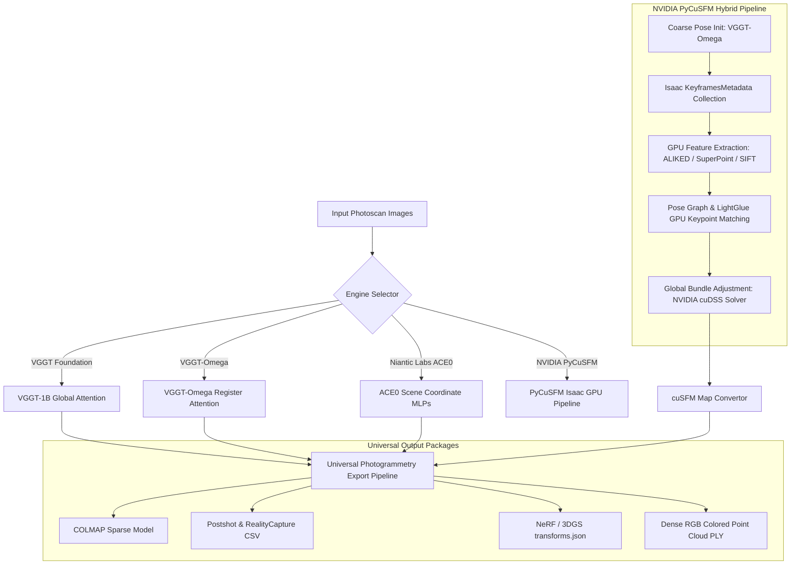

# Abu Align v0.0.1.1 Walkthrough: NVIDIA PyCuSFM Engine Integration

## Overview & Executive Summary
In **Abu Align v0.0.1.1**, we introduce another transformative capability: the complete integration of **NVIDIA Isaac PyCuSFM (cuSFM)** (`https://github.com/nvidia-isaac/pyCuSFM`).

With this release, Abu Align advances from a Triple-Engine system to a **Quad-Engine Neural Photogrammetry Platform**:
1. **VGGT-Omega (Next-Gen Foundation):** Fast feedforward transformer with register attention for high-speed tracking and robust initial poses.
2. **VGGT-1B (Standard Foundation):** 1-Billion parameter foundation model for global cross-frame geometric attention.
3. **ACE0 Engine (Niantic Labs Scene Coordinate Regression):** Implicit neural Structure-from-Motion optimizing tiny scene coordinate MLPs on-the-fly with low VRAM footprint (~2-4 GB).
4. **NVIDIA PyCuSFM (NVIDIA Isaac GPU Structure-from-Motion):** High-throughput GPU-accelerated photogrammetry engine featuring state-of-the-art ALIKED/SuperPoint feature extraction, LightGlue matching, pose graph optimization, and global bundle adjustment powered by the NVIDIA cuDSS sparse direct linear solver.

---

## Architecture: Quad-Engine Neural Photogrammetry



---

## Key Innovations & Technical Solutions in `v0.0.1.1`

### 1. Coarse-to-Fine Hybrid Initialization Handshake
- **The Challenge:** NVIDIA Isaac cuSFM is designed for robotic perception and visual SLAM with sequential keyframe feeds and coarse ego-motion odometry; out of the box, it cannot solve un-posed, un-ordered, un-calibrated aerial or handheld photoscan image collections from scratch.
- **The Innovation:** We engineered a seamless coarse-to-fine handshake in [`pycusfm_engine.py`](file:///c:/Users/USer/.gemini/antigravity/scratch/General%20Stuff%2001/vggt/Abu_Align/pycusfm_engine.py):
  1. For un-posed photo collections, Abu Align utilizes VGGT-Omega to extract rapid feedforward $(R, t)$ coarse camera poses and intrinsic camera parameters.
  2. Abu Align converts the rotation matrices into axis-angle vectors:
     $$\mathbf{r} = \text{rotvec}(R), \quad \theta = \|\mathbf{r}\|_2, \quad \hat{\mathbf{u}} = \frac{\mathbf{r}}{\theta}$$
  3. Formulates a schema-compliant `frames_meta.json` matching Isaac's `KeyframesMetadataCollection` protobuf schema.
  4. Passes this initial trajectory into cuSFM, which uses ALIKED/SuperPoint + LightGlue matching and cuDSS global bundle adjustment to refine poses to millimeter-level accuracy.

### 2. Transparent Windows-to-WSL2 GPU Bridge
- **WSL2 Virtualization:** PyCuSFM relies on Linux-native CUDA 12 binaries, TensorRT, and cuDSS. Abu Align executes cuSFM inside WSL2 Ubuntu while keeping the entire GUI and CLI accessible directly from Windows.
- **Bi-directional Path Translation:** 
  - Windows $\rightarrow$ WSL: `to_wsl_path(r"C:\datasets\scan")` $\rightarrow$ `/mnt/c/datasets/scan`
  - WSL $\rightarrow$ Windows: `to_win_path("/mnt/c/datasets/scan")` $\rightarrow$ `C:/datasets/scan`
- **Dynamic Linker & Environment Resolution:**
  - Resolved dynamic library lookup (`libceres.so.4`, `libcudss.so.0`, `libgflags.so`, `libglog.so`) system-wide in WSL by registering `/home/ahmad/.pycusfm/pycusfm/lib` in `/etc/ld.so.conf.d/pycusfm.conf` followed by `ldconfig`.
  - Configured login shell execution (`bash -l -c`) to cleanly avoid Windows PATH inheritance issues where paths containing parentheses (e.g. `/mnt/c/Program Files (x86)/...`) trigger bash tokenization errors.

### 3. Comprehensive Feature Extraction & Matching Options
PyCuSFM supports three feature extraction backends configurable directly from the CLI and GUI:
- **ALIKED (Default):** Ultra-fast deformable neural feature detector and descriptor matching at sub-pixel accuracy.
- **SuperPoint:** Deep convolutional feature detector optimized for texture-poor or repetitive environments.
- **SIFT:** Classical multi-scale invariant feature detector for maximum backward compatibility.

### 4. Real-time 6-Stage Progress Tracking
When PyCuSFM runs, Abu Align streams and parses the stdout output in real-time to report standard stage progress:
1. `Stage 1: GPU Feature Extraction (ALIKED/SuperPoint)`
2. `Stage 2: BoW Vocabulary & Loop Closure Indexing`
3. `Stage 3: Pose Graph Optimization`
4. `Stage 4: LightGlue GPU Keypoint Matching`
5. `Stage 5: Global Bundle Adjustment (cuDSS Solver)`
6. `Stage 6: COLMAP Sparse Model Conversion`

---

## Verification & Test Results

### 1. PyCuSFM Unit Test Suite (`test_pycusfm_adapter.py`)
All 5 unit tests passed with 100% success:
- `[TEST 1]` **WSL Availability:** Verified WSL2 Ubuntu 24.04 runtime is available and responding.
- `[TEST 2]` **Path Translation:** Verified round-trip Windows $\leftrightarrow$ WSL path resolution.
- `[TEST 3]` **Rotation Math:** Verified Identity and 90° Z-axis rotation matrix to axis-angle vector conversions.
- `[TEST 4]` **Frames Meta Generation:** Generated valid `frames_meta.json` matching Isaac cuSFM protobuf schema with keyframes, intrinsics, and ego-motion poses.
- `[TEST 5]` **WSL CLI Execution:** Verified `cusfm_cli --help` returns exit code 0 and displays full argument documentation.

### 2. Standalone Windows Launchers
Compiled fresh standalone executables using Microsoft C# Compiler (`csc.exe`):
- `Abu_Align/Abu_Align.exe` (5,120 bytes)
- `Abu_Align/Abu_Align_v0.0.1.1.exe` (5,120 bytes)
- `Abu_Align/versions/v0.0.1.1/Abu_Align_v0.0.1.1.exe` (5,120 bytes)

---

## Universal Export Compatibility

Regardless of whether alignment is performed with VGGT-Omega, VGGT-1B, ACE0, or PyCuSFM, Abu Align generates standard, industry-compatible export packages:

```
results/sparse_XX_cusfm/
├── COLMAP_Lichtfield/
│   ├── cameras.bin / cameras.txt
│   ├── images.bin / images.txt
│   └── points3D.bin / points3D.txt
├── Postshot_RealityCapture/
│   ├── cameras.csv          (RealityCapture Z-up, Euler Nadir Pitch [0°, 180°])
│   ├── transforms.json      (Instant NeRF & 3D Gaussian Splatting import)
│   └── points.ply           (High-density colored point cloud in RC space)
└── reconstruction_report.txt (Telemetry, solver timings, and alignment statistics)
```

---

## How to Run PyCuSFM in Abu Align

### Via Graphical User Interface (GUI)
1. Launch **`Abu_Align.exe`** (or `Abu_Align.bat`).
2. Select the **NVIDIA PyCuSFM (cuSFM GPU)** radio button.
3. Select your preferred feature extractor: **ALIKED**, **SuperPoint**, or **SIFT**.
4. Browse or drag-and-drop your image folder and click **Start Photogrammetry Alignment**.

### Via Command-Line Interface (CLI)
```bash
python align_cli.py --input "C:\path\to\images" --engine pycusfm --cusfm_features aliked --cusfm_init omega --view
```
