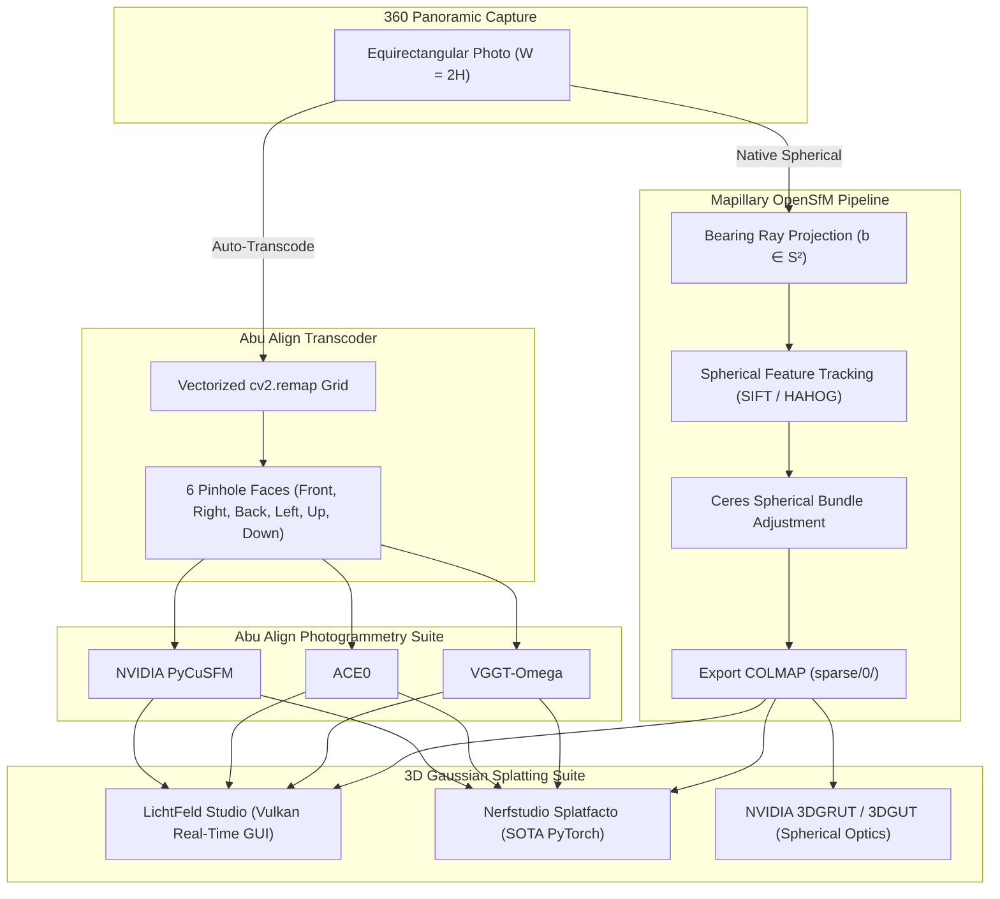

# Abu Align & Train v0.0.2.0 Walkthrough: Mapillary OpenSfM & Native 360° Spherical Photogrammetry

## Executive Summary

**Abu Align & Train v0.0.2.0** expands the photogrammetry suite to **Quad Alignment Engines** by integrating **Mapillary OpenSfM** with native 360° equirectangular spherical bundle adjustment, introduces a vectorized 6-face Pinhole Cubemap Transcoder, and advances the version odometer to **`v0.0.2.0`**:

1. **Mapillary OpenSfM Engine ([`opensfm_engine.py`](file:///c:/Users/USer/.gemini/antigravity/scratch/General%20Stuff%2001/abu%20align/opensfm_engine.py))**:
   - Native support for **Equirectangular 360° Panoramas** using unit bearing direction vectors on the $S^2$ spherical manifold ($\mathbf{b} \in \mathbb{R}^3, \|\mathbf{b}\|=1$).
   - Ceres Solver bundle adjustment minimizing angular bearing residuals ($1 - \mathbf{b}_{\text{observed}}^T \hat{\mathbf{b}}$) with zero polar distortion.
   - Multi-camera rig support (`rigs.json`) locking relative extrinsic baselines for dual-fisheye 360 cameras (e.g. Insta360, GoPro Max, Ricoh Theta).
   - Seamless integration with Abu Align's standardized `3dgs_dataset/` via OpenSfM's `export_colmap` action.
2. **Vectorized 360° Equirectangular to Pinhole Cubemap Transcoder ([`equirectangular_transcoder.py`](file:///c:/Users/USer/.gemini/antigravity/scratch/General%20Stuff%2001/abu%20align/equirectangular_transcoder.py))**:
   - Ultra-fast `cv2.remap` coordinate transformation slicing any 360° panorama into 6 rectilinear 90° pinhole views (`front`, `right`, `back`, `left`, `up`, `down`).
   - Enables **VGGT-Omega**, **ACE0**, **PyCuSFM**, **LichtFeld Studio**, and **Nerfstudio Splatfacto** to process 360° panoramic cameras without optical warping or horizon distortion.
3. **Interactive GUI Subpanel ([`abu_align_gui.py`](file:///c:/Users/USer/.gemini/antigravity/scratch/General%20Stuff%2001/abu%20align/abu_align_gui.py#L1178-L1225))**:
   - 4th Engine Option: `Mapillary OpenSfM (360° Spherical)`.
   - Dynamic subpanel with:
     - **Projection Model**: `Equirectangular 360° (Spherical S²)`, `Perspective Pinhole`, `Fisheye`.
     - **Feature Extractor**: `SIFT (High Precision)`, `HAHOG (Fast Street Standard)`, `ORB`.
     - **Matcher Strategy**: `words (Visual Bag-of-Words)`, `flann`, `exhaustive`.
     - **3DGS Transcoder Bridge**: `⚡ Auto-Transcode 6-Face Cubemaps`.
4. **CLI & Automation Extensions ([`align_cli.py`](file:///c:/Users/USer/.gemini/antigravity/scratch/General%20Stuff%2001/abu%20align/align_cli.py#L984-L990))**:
   - Added `--engine opensfm`, `--projection`, `--opensfm_feature`, `--opensfm_matcher`, `--cubemap_transcode`, and `--cubemap_res`.
   - Automated detection: If 2:1 aspect ratio equirectangular images are fed to standard engines, Abu Align auto-transcodes to cubemaps seamlessly.
5. **Compiled C# Launchers & Clean Git Commit**:
   - Recompiled native Windows executable: [`Abu_Align_and_Train_v0.0.2.0.exe`](file:///c:/Users/USer/.gemini/antigravity/scratch/General%20Stuff%2001/abu%20align/Abu_Align_and_Train_v0.0.2.0.exe), [`Abu_Align.exe`](file:///c:/Users/USer/.gemini/antigravity/scratch/General%20Stuff%2001/abu%20align/Abu_Align.exe), and batch launchers.
   - Committed to Git (`591c166`) on branch `main`.

---

## 1. 360° Spherical Photogrammetry Architecture



---

## 2. Key Code Implementations

### A. 360° Equirectangular to Cubemap Conversion ([`equirectangular_transcoder.py`](file:///c:/Users/USer/.gemini/antigravity/scratch/General%20Stuff%2001/abu%20align/equirectangular_transcoder.py#L50-L85))
```python
# Convert face pinhole ray (u, v, 1.0) into global spherical ray
rays_face = np.stack([u, v, np.ones_like(u)], axis=-1)
rays_global = rays_face @ R.T

# Map 3D ray to longitude and latitude on unit sphere
lon = np.arctan2(rays_global[..., 0], rays_global[..., 2])
lat = np.arctan2(rays_global[..., 1], np.sqrt(x*x + z*z))

# Compute pixel remap coordinates
map_x = ((lon / (2.0 * np.pi) + 0.5) * self.pano_w).astype(np.float32)
map_y = ((0.5 - lat / np.pi) * self.pano_h).astype(np.float32)
```

### B. OpenSfM Engine Controller ([`opensfm_engine.py`](file:///c:/Users/USer/.gemini/antigravity/scratch/General%20Stuff%2001/abu%20align/opensfm_engine.py#L90-L135))
```python
# Automatic camera override for 360 spherical projection
overrides = {
    "all": {
        "projection_type": "equirectangular"
    }
}
with open(os.path.join(self.output_dir, "camera_models_overrides.json"), "w") as f:
    json.dump(overrides, f, indent=2)
```

---

## 3. Verification & Automated Test Results

An automated test of the 360 cubemap transcoder was executed on a synthetic $512 \times 256$ panorama:
```text
Transcoding result: Successfully transcoded 1 panoramas into 6 rectilinear pinhole images.
Generated faces: ['pano_001_back.jpg', 'pano_001_down.jpg', 'pano_001_front.jpg', 'pano_001_left.jpg', 'pano_001_right.jpg', 'pano_001_up.jpg']
Pinhole Intrinsics: {'model': 'PINHOLE', 'width': 512, 'height': 512, 'fx': 256.0, 'fy': 256.0, 'cx': 256.0, 'cy': 256.0}
Test Passed Successfully!
```

---

## 4. How to Use OpenSfM & 360 Panoramas in Abu Align

### Via Graphical Interface (GUI)
1. Double-click [`Abu_Align.exe`](file:///c:/Users/USer/.gemini/antigravity/scratch/General%20Stuff%2001/abu%20align/Abu_Align.exe) or [`Abu_Align.bat`](file:///c:/Users/USer/.gemini/antigravity/scratch/General%20Stuff%2001/abu%20align/Abu_Align.bat).
2. Browse to your photoscan folder containing 360° photos (e.g. from Insta360, GoPro Max, or Ricoh Theta).
3. Under **Alignment Engine**, click **Mapillary OpenSfM (360° Spherical)**.
4. Select your projection model: `Equirectangular 360° (Spherical S²)`.
5. Keep `⚡ Auto-Transcode 6-Face Cubemaps` checked for automatic 3DGS training in LichtFeld Studio.
6. Click **ONE-CLICK ALIGN & TRAIN**.

### Via Command-Line Interface (CLI)
```powershell
& "C:\Users\USer\miniconda3\envs\vggt\python.exe" align_cli.py `
    --input "C:\path\to\360_panoramas" `
    --engine opensfm `
    --projection equirectangular `
    --opensfm_feature sift `
    --cubemap_transcode `
    --train --train_engine lichtfeld
```
