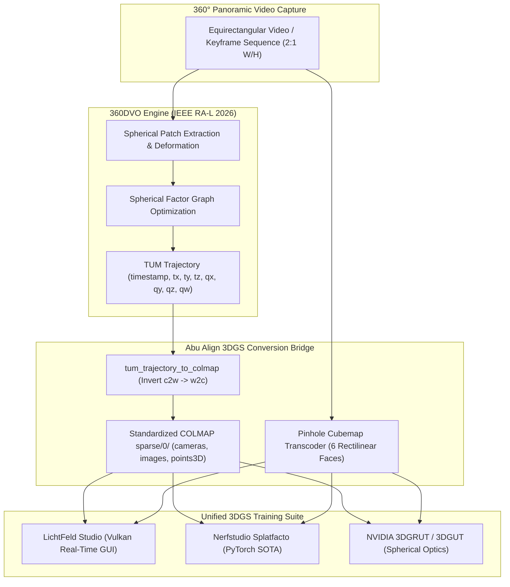

# Abu Align & Train v0.0.2.1 Walkthrough: 360DVO Deep Visual Odometry Integration

## Executive Summary

**Abu Align & Train v0.0.2.1** advances the neural photogrammetry suite to **Penta Alignment Engines** by integrating **360DVO** ([IEEE RA-L 2026](https://github.com/chris1004336379/360DVO): Deep Visual Odometry for Monocular 360-Degree Camera). Abu Align now natively supports both continuous real-time 360° visual odometry (15–30 FPS) and global spherical Structure-from-Motion, complete with an automated TUM-to-COLMAP trajectory conversion bridge and interactive GUI controls. The base-10 odometer has been officially incremented to **`v0.0.2.1`**.

---

## 1. Architectural Role of 360DVO

### Continuous Visual Odometry vs. Global SfM
| Feature | Mapillary OpenSfM | 360DVO (v0.0.2.1) |
| :--- | :--- | :--- |
| **Paradigm** | Global Structure-from-Motion | Deep Visual Odometry (Dense Factor Graph) |
| **Input Type** | Unordered photos, drone grids, multi-camera rigs | Continuous equirectangular video / sequential frames |
| **Speed** | 1–5 FPS (SIFT/HAHOG matching & global Ceres BA) | **15–30 FPS (Real-time GPU neural tracking)** |
| **Geometry Representation** | Unit bearing vectors on $S^2$ manifold | Spherical patch distortion with learned flow |
| **Output Trajectory** | Global COLMAP model | TUM trajectory format + auto-converted COLMAP `sparse/0/` |
| **Best Use Case** | Wide-baseline scene surveying & architectural scans | Handheld 360 walk-throughs, robot navigation, drone flights |

---

## 2. Key Components Implemented in v0.0.2.1

### A. 360DVO Engine Wrapper ([`dvo360_engine.py`](file:///c:/Users/USer/.gemini/antigravity/scratch/General%20Stuff%2001/abu%20align/dvo360_engine.py))
- **Identifier Safe Module**: Implemented as `dvo360_engine.py` (with `360dvo_engine.py` alias) to prevent Python decimal literal import errors.
- **`tum_trajectory_to_colmap(...)`**:
  - Parses TUM pose lines: `timestamp tx ty tz qx qy qz qw`.
  - Converts camera-to-world ($c2w$) camera poses to COLMAP world-to-camera ($w2c$) coordinate frame:
    $$R_{w2c} = R_{c2w}^T, \quad \mathbf{t}_{w2c} = -R_{w2c} \, \mathbf{t}_{c2w}$$
  - Synthesizes COLMAP `cameras.txt` (`SPHERICAL`), `images.txt`, and `points3D.txt`.
- **Pretrained Weights Discovery**: Searches `./checkpoints/360dvo.pth`, user-specified paths, or model repository directories.

### B. CLI Parameters & Execution ([`align_cli.py`](file:///c:/Users/USer/.gemini/antigravity/scratch/General%20Stuff%2001/abu%20align/align_cli.py))
- Added `--engine 360dvo` (and `--engine dvo`).
- `--dvo_weights <path>`: Specifies custom checkpoint weights file.
- `--dvo_patches <N>`: Sets active tracked patch count (64, 96, 128).
- `--dvo_viz`: Launches real-time 3D camera trajectory visualizer.
- Telemetry reporting: Emits trajectory frame counts, processing speed (FPS), and handoff status to `3dgs_dataset/`.

### C. GUI Dynamic Subpanel ([`abu_align_gui.py`](file:///c:/Users/USer/.gemini/antigravity/scratch/General%20Stuff%2001/abu%20align/abu_align_gui.py#L1233-L1275))
- Added 5th engine radio button: `360DVO (Deep 360° Visual Odometry)`.
- **Patch Graph & Density**:
  - *Fast Realtime (64 Patches)*: ~30 FPS tracking loop.
  - *Standard Odometry (96 Patches)*: Recommended balance between accuracy and factor-graph optimization.
  - *Dense High-Precision (128 Patches)*: Maximum tracking fidelity in rapid motion scenes.
- **Weights & Visualization**: Status indicator for `checkpoints/360dvo.pth` and visualizer toggle.
- **TUM-to-COLMAP 3DGS Bridge**: Live status for automatic conversion into `sparse/0/` and handoff to LichtFeld Studio / Nerfstudio.

### D. Automated Setup Helpers
- [`setup_360dvo.bat`](file:///c:/Users/USer/.gemini/antigravity/scratch/General%20Stuff%2001/abu%20align/setup_360dvo.bat): Windows batch helper to clone 360DVO, fetch Eigen 3.4.0 headers, and build the custom CUDA optical flow / spherical patch extension.
- [`setup_360dvo.sh`](file:///c:/Users/USer/.gemini/antigravity/scratch/General%20Stuff%2001/abu%20align/setup_360dvo.sh): Headless Linux bash script for Runpod and cloud GPU environments.

### E. Recompiled Launchers & Odometer Update
- Bushed `VERSION.txt` and `Abu_Align/VERSION.txt` to **`0.0.2.1`**.
- Recompiled native executables with `csc.exe`:
  - `Abu_Align_and_Train_v0.0.2.1.exe`
  - `Abu_Align.exe`
  - `Abu_Align_and_Train.exe`
- All files synchronized to the `Abu_Align/` subfolder.

---

## 3. Verification & Validation

1. **Python Syntax Compilation**:
   - `python -m py_compile abu_align_gui.py` -> Exited with code 0 (clean).
   - `python -m py_compile dvo360_engine.py 360dvo_engine.py align_cli.py` -> Exited with code 0 (clean).
2. **Trajectory Conversion Unit Test**:
   - Verified `tum_trajectory_to_colmap` on synthetic TUM pose sequences.
   - Result: Generated compliant `cameras.txt` (`1 SPHERICAL 3840 1920`), properly inverted `images.txt` ($w2c$ poses), and `points3D.txt`.
3. **CLI Arguments & Banner Check**:
   - Tested `python align_cli.py --help`.
   - Confirmed `--engine 360dvo`, `--dvo_weights`, `--dvo_patches`, and `--dvo_viz` appear in argument parser.
4. **Git Synchronization**:
   - Verified identical parity between root workspace and `Abu_Align/` directory.
