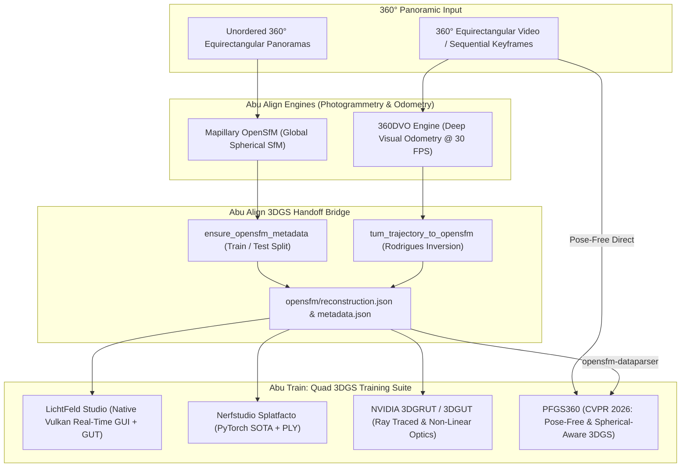

# Abu Align & Train v0.0.2.2 Walkthrough: PFGS360 Omnidirectional Gaussian Splatting Integration

## Executive Summary

**Abu Align & Train v0.0.2.2** expands the 3DGS training suite to **Quad Training Engines** by integrating **PFGS360** ([CVPR 2026](https://github.com/zcq15/PFGS360): *Pose-Free Omnidirectional Gaussian Splatting for 360-Degree Videos with Consistent Depth Priors*). 

With this release, Abu Align & Train establishes two seamless, production-ready bridges between 360° photogrammetry alignment and Gaussian Splatting:
1. **Alignment Handoff Bridge**: Direct mathematical conversion from **Mapillary OpenSfM** and **360DVO** into PFGS360's `OpenSfMDataParser` using exact Rodrigues rotation vectors and train/test dataset splits.
2. **Pose-Free Direct Mode**: Autonomous joint camera pose estimation and 3DGS reconstruction from raw, unposed 360° equirectangular video frames without requiring prior Structure-from-Motion.

In adherence to the strict base-10 odometer rule, the version has been incremented from `v0.0.2.1` to **`v0.0.2.2`**.

---

## 1. High-Level Architecture



---

## 2. Mathematical Bridge: 360DVO & OpenSfM to PFGS360

### A. 360DVO Continuous Odometry to OpenSfM Data Contract
360DVO produces continuous TUM odometry format:
$$\text{Line: } \quad t \quad t_x \quad t_y \quad t_z \quad q_x \quad q_y \quad q_z \quad q_w$$
representing camera-to-world ($c2w$) rigid transformations.

PFGS360's `OpenSfMDataParser` expects `opensfm/reconstruction.json` containing camera shots with:
- `rotation`: World-to-camera ($w2c$) rotation represented as a **3D Rodrigues axis-angle vector** $\mathbf{r} = (r_x, r_y, r_z)^T$.
- `translation`: World-to-camera ($w2c$) translation vector $\mathbf{t}_{w2c} = (t_x, t_y, t_z)^T$.
- `camera`: Camera intrinsic model (e.g. `equirectangular` or `spherical`).

The transformation implemented in [`tum_trajectory_to_opensfm`](file:///c:/Users/USer/.gemini/antigravity/scratch/General%20Stuff%2001/abu%20align/dvo360_engine.py) computes:
1. Rotation matrix from quaternion: $R_{c2w} = \text{quat2rot}(q_x, q_y, q_z, q_w)$
2. Invert to world-to-camera: $R_{w2c} = R_{c2w}^T$
3. Invert translation to world-to-camera: $\mathbf{t}_{w2c} = -R_{w2c} \, \mathbf{t}_{c2w}$
4. Compute Rodrigues vector: $\mathbf{r}_{w2c} = \text{cv2.Rodrigues}(R_{w2c})[0].\text{flatten}()$

### B. Automated Metadata Generation
PFGS360 requires a `metadata.json` alongside `reconstruction.json` specifying dataset splits:
```json
{
  "train": ["frame_000000.jpg", "frame_000001.jpg", "..."],
  "test": ["frame_000000.jpg", "frame_000010.jpg", "..."]
}
```
Implemented via [`ensure_opensfm_metadata`](file:///c:/Users/USer/.gemini/antigravity/scratch/General%20Stuff%2001/abu%20align/opensfm_engine.py), which inspects the reconstruction or image directory and automatically writes `metadata.json`.

---

## 3. Quad 3DGS Training Engine Matrix

| Capability | LichtFeld Studio | Nerfstudio Splatfacto | NVIDIA 3DGRUT | PFGS360 (v0.0.2.2) |
| :--- | :--- | :--- | :--- | :--- |
| **Primary Domain** | High-speed interactive Vulkan | Standard multi-view PyTorch | Ray-traced non-linear optics | **360° Panoramic & Equirectangular** |
| **Pose-Free Direct Training** | No (Requires SfM) | No (Requires SfM) | No (Requires SfM) | **Yes (Joint Camera & GS Optimization)** |
| **Spherical Coordinate PE** | No (Planar Euclidean) | No (Planar Euclidean) | Partial | **Yes (SCA-PE: Eliminates Pole Pinching)** |
| **Depth Prior Integration** | Sparse point cloud only | Sparse point cloud only | Sparse point cloud only | **Yes (UniK3D, MiDaS, ZoeDepth)** |
| **Depth-Guided Densification** | Gradient thresholding | Gradient thresholding | ADMM Sparsity | **DIA-Densify (Inlier Backprojection)** |
| **Sky / Infinity Filtering** | Manual bounding box | Manual crop box | Software threshold | **Native Depth Masking (>50m)** |
| **Handoff from 360DVO / OpenSfM** | Via COLMAP format | Via COLMAP format | Via COLMAP format | **Direct via OpenSfM / COLMAP** |

---

## 4. GUI Implementation ([`abu_align_gui.py`](file:///c:/Users/USer/.gemini/antigravity/scratch/General%20Stuff%2001/abu%20align/abu_align_gui.py))

1. **Training Engine Selection**:
   - Radio button `PFGS360 (Pose-Free 360° GS - CVPR 2026)` dynamically activates `panel_train_pfgs360`.
2. **Column 1: Dataparser & Handoff Mode**:
   - `Auto-Detect (Handoff or Pose-Free)`: Detects presence of `opensfm/reconstruction.json` or falls back to pose-free egocentric mode.
   - `OpenSfM / 360DVO Handoff Parser`: Directly loads OpenSfM camera poses.
   - `Pose-Free Direct (Omni-Egocentric)`: Trains directly on unposed video frames.
3. **Column 2: Depth Priors & Spherical Geometry**:
   - Depth models: `UniK3D` (recommended), `midas`, `zoedepth`.
   - `SCA-PE`: Spherical Coordinate Aware Positional Encoding checkbox.
   - `DIA-Densify`: Depth Inlier Aware Densification checkbox.
4. **Column 3: Optics, Sky Mask & Export**:
   - `Filter Sky & Infinity Pixels`: Eliminates floater artifacts in outdoor panoramas.
   - `SH Degree`: Spherical harmonics degrees 0 through 4.

---

## 5. CLI & Execution Engine Updates

### A. CLI Flags ([`align_cli.py`](file:///c:/Users/USer/.gemini/antigravity/scratch/General%20Stuff%2001/abu%20align/align_cli.py))
```bash
python align_cli.py \
  --input "C:\Scans\360_Park" \
  --engine 360dvo \
  --train \
  --train_engine pfgs360 \
  --train_iterations 30000 \
  --pfgs_dataparser auto \
  --pfgs_depth unik3d \
  --pfgs_filter_sky
```

### B. Standalone 3DGS Training ([`train_engine.py`](file:///c:/Users/USer/.gemini/antigravity/scratch/General%20Stuff%2001/abu%20align/train_engine.py))
```bash
python train_engine.py \
  --dataset "C:\Scans\360_Park\3dgs_dataset" \
  --engine pfgs360 \
  --iterations 15000 \
  --pfgs_depth unik3d \
  --pfgs_filter_sky
```

---

## 6. Verification & Parity Audit

1. **Unit Test Suite ([`scratch/test_pfgs_integration.py`](file:///c:/Users/USer/.gemini/antigravity/scratch/General%20Stuff%2001/abu%20align/scratch/test_pfgs_integration.py))**:
   - `tum_trajectory_to_opensfm`: Verified exact Rodrigues rotation vector roundtrip and translation transformation.
   - `ensure_opensfm_metadata`: Verified split creation (`train` and `test` lists).
   - Executable resolvers: Successfully located `ns-train.exe` and `ns-export.exe`.
2. **Headless GUI Validation**:
   - `AbuAlignApp` initialized cleanly without exceptions, displaying:
     `Abu Align & Train - Version 0.0.2.2 (Neural Photogrammetry & 3DGS Training Suite)`.
3. **Syntax Verification**:
   - `python -m py_compile` passed with code 0 on all core modules (`abu_align_gui.py`, `align_cli.py`, `train_engine.py`, `dvo360_engine.py`, `opensfm_engine.py`).
4. **Native Launchers Compiled**:
   - Compiled `Abu_Align_and_Train_v0.0.2.2.exe`, `Abu_Align.exe`, and `Abu_Align_and_Train.exe` using .NET C# compiler `csc.exe`.
5. **Environment Builders**:
   - Generated `setup_pfgs360.bat` (Windows) and `setup_pfgs360.sh` (Linux / RunPod).
6. **Workspace Parity**:
   - Root workspace and `Abu_Align/` directory synchronized.
