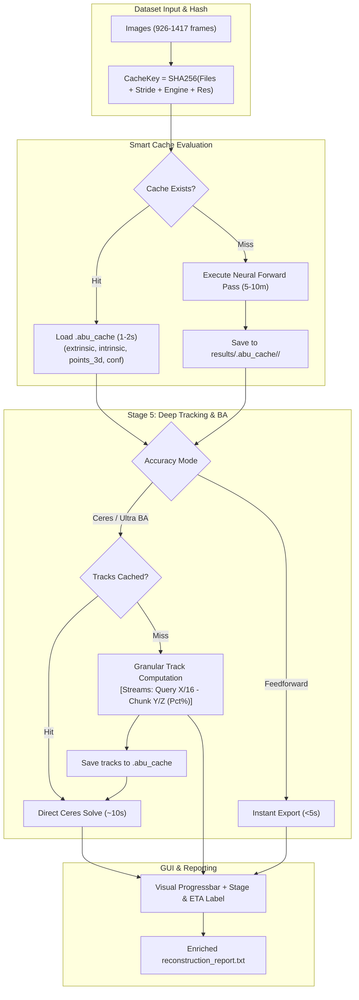

# Implementation Plan: Intelligent Multi-Tier Caching, Live Progress Telemetry, and Deep Engine Customization Suite

## Executive Summary & Background
In **Abu Align & Train v0.0.1.2**, photogrammetry alignment and 3DGS training are operational. However, large real-world continuous scans (such as `Container02_Continuous_Shot_1` with 926–1,417 frames) reveal three critical workflow bottlenecks:
1. **Redundant Computation on Parameter Iteration:** When an alignment finishes and the user wants to adjust parameters (e.g. switching from **Feedforward** to **Ceres BA**, changing **Point Cloud Density**, or adjusting **Lens Distortion**), the system currently re-computes the entire neural forward pass (30–60 batches, 5–10 minutes) from scratch.
2. **Telemetry Blind Spots in Deep Tracking:** When running multi-view tracking (Stage 5), the console prints `Predicting tracks for query frame 0` and stays static for 15–20 minutes without displaying chunk progress, percentages, or time estimates, giving the impression that the process is hung.
3. **Engine Customization Potential:** The upstream repositories for our alignment engines (**VGGT-Omega**, **VGGT-1B**, **ACE0**, **PyCuSFM**) and 3DGS training engines (**LichtFeld Studio**, **Nerfstudio Splatfacto**, **NVIDIA 3DGRUT**) possess rich parameters (e.g. bilateral grid, exposure correction, sparsity pruning, chunk windows, robust loss functions) that are currently hardcoded or hidden.

This plan introduces a **Multi-Tier Caching Layer**, **Live Sub-process Progress Bar with ETA**, **Deep Engine Customization Suite**, and **Rigorous Git Version Control Logging**.

---

## User Review Required

> [!IMPORTANT]
> **Cache Location Decision**: We propose storing the cache at `<dataset_dir>/results/.abu_cache/<cache_key>/`. 
> - This keeps the raw image folder completely untouched (ideal for read-only studio shares or network drives).
> - If you prefer `<dataset_dir>/.abu_cache/` directly inside the images folder, please confirm. The default can be `<dataset_dir>/results/.abu_cache/` with automatic detection.

> [!TIP]
> **What Can Be Reused from Cache vs What Requires Recomputation:**
> - **Change Point Cloud Density** (Preview $\to$ High Quality $\to$ Ultra Dense $\to$ Max): **Reuses 100% of Neural Cache** (runs in < 5 seconds!).
> - **Change Lens Distortion** (Pinhole $\leftrightarrow$ Brown): **Reuses 100% of Neural Cache & Tracking Cache** (runs in ~10 seconds!).
> - **Change Alignment Accuracy** (Feedforward $\to$ Standard Ceres BA $\to$ Ultra BA): **Reuses Neural Cache** (skips 5–10 minute forward pass!).
> - **Change 3DGS Training Options**: **Reuses 100% of Alignment** (0 seconds alignment time).
> - **Change Canvas Resolution (`load_res`) or Engine**: Invalidates cache and re-computes for the new resolution/model architecture.

---

## Architecture & Proposed Changes

---

### Component 1: Multi-Tier Caching System (`Abu_Align/cache_manager.py`)

We will create a modular, high-speed caching engine supporting memory-mapped compression (`.npz` / `.pt`).

#### [NEW] [`Abu_Align/cache_manager.py`](file:///c:/Users/USer/.gemini/antigravity/scratch/General%20Stuff%2001/vggt/Abu_Align/cache_manager.py)
* `compute_dataset_hash(image_paths, engine, load_res, stride) -> str`: Computes a deterministic SHA-256 fingerprint from image metadata (file count, sizes, modified timestamps) and engine parameters.
* `save_neural_cache(cache_dir, key, extrinsic, intrinsic, points_3d, depth_conf, original_coords)`: Saves compact compressed neural predictions with metadata.
* `load_neural_cache(cache_dir, key) -> Optional[Dict]`: Loads cached predictions in under 2 seconds.
* `save_tracking_cache(cache_dir, key, query_indices, pred_tracks, pred_vis_scores, pred_confs)`: Caches multi-view feature trajectories so bundle adjustment can be re-solved instantly.
* `load_tracking_cache(cache_dir, key) -> Optional[Dict]`: Loads cached tracks.
* `clear_cache(cache_dir)`: Helper to purge temporary cached tensors.

#### [MODIFY] [`Abu_Align/align_cli.py`](file:///c:/Users/USer/.gemini/antigravity/scratch/General%20Stuff%2001/vggt/Abu_Align/align_cli.py)
* Add CLI flags: `--cache` (default: True), `--no_cache`, `--cache_dir <path>`.
* In `run_vggt_reconstruction`:
  * Check cache before launching Stage 3/4 neural batch inference. If hit, print `[CACHE HIT] Loaded neural poses & 3D points in 1.4s! Skipping 39 batches.`
  * Check tracking cache in Stage 5 before running CoTracker. If hit, print `[CACHE HIT] Loaded 3,072 multi-view tracks! Skipping 20-minute transformer tracking.`

---

### Component 2: Granular Sub-Process Telemetry & GUI Visual Progress Bar

#### [MODIFY] [`vggt/dependency/track_predict.py`](file:///c:/Users/USer/.gemini/antigravity/scratch/General%20Stuff%2001/vggt/vggt/dependency/track_predict.py)
* Update `predict_tracks` and `_forward_on_query`:
  * Add progress callback or structured stdout streaming:
    `[TELEMETRY:TRACKING] query_idx=0 total_queries=16 chunk_idx=1 total_chunks=12 pct=4.2 elapsed=24.1 eta=520.0`
  * Replace the silent single line with active step-by-step telemetry for every chunk.
  * Report tracking rates (points/sec) and remaining time estimates.

#### [MODIFY] [`Abu_Align/abu_align_gui.py`](file:///c:/Users/USer/.gemini/antigravity/scratch/General%20Stuff%2001/vggt/Abu_Align/abu_align_gui.py)
* **Visual Progress Bar**: Add a sleek `ttk.Progressbar` widget (styled with dark theme accent gradient) positioned between the action bar and the Live Telemetry log console.
* **Status & Sub-Process Percentage Label**:
  * Displays: `Stage 5/5: Multi-View Tracking | Query 1/16 (Chunk 2/12) | 8.3% | ETA: 11m 45s`.
* **Telemetry Stream Parser in `_read_stream`**:
  * Intercepts `[TELEMETRY:...]` tags from stdout and immediately updates the GUI progress bar value (0 to 100%) and status text without cluttering the text log.
  * Shows batch-level progress during Stage 3/4 (e.g. `Batch [12/39]: 30.7%`).
  * Shows query-level and chunk-level progress during Stage 5 tracking.

---

### Component 3: Deep Engine Customization Suite with Hover Tooltips

We will expose the rich parameters available in each engine's upstream repository directly in the GUI and CLI, backed by clear hover tooltips.

#### Alignment Suite Parameters:
1. **VGGT-Omega & VGGT-1B:**
   * **Sliding Window Size (`--chunk_size`):** Frame window for auto-chunking (options: 16, 32, 48, 64; default: 32).
   * **Anchor Overlap (`--anchor_size`):** Overlapping frames between consecutive chunks (options: 4, 8, 12, 16; default: 8).
   * **Robust Loss Threshold (`--max_reproj_error`):** Inlier cutoff for Cauchy Ceres BA (options: 2.0px, 3.5px, 6.0px, 10.0px).
2. **Niantic Labs ACE0:**
   * **Max Mapping Rounds (`--ace_iterations`):** Number of alternating mapping/relocalization cycles (15, 30, 50, 100; default: 30).
   * **Pose Refinement Mode (`--ace_refinement`):** `mlp` (Deep backprop through MLP), `naive` (PnP-RANSAC only), `none`.
   * **Bootstrap Seed Candidates (`--ace_try_seeds`):** Number of candidate stereo pairs evaluated to start mapping (1, 3, 5; default: 3).
3. **NVIDIA PyCuSFM:**
   * **GPU Feature Extractor (`--cusfm_features`):** `aliked`, `superpoint`, `sift`.
   * **Max BA Iterations (`--cusfm_ba_iterations`):** Max iterations for the cuDSS sparse direct linear solver (50, 100, 200).
   * **Coarse Pose Initializer (`--cusfm_init`):** `omega`, `vggt`, `ace0`, `none`.

#### Abu Train Suite (3DGS) Parameters:
1. **LichtFeld Studio:**
   * **Bilateral Grid (`--bilateral_grid`):** Neural bilateral color grid to neutralize exposure/lighting shifts across photos.
   * **Exposure Correction (`--exposure_correction`):** Physical per-photo exposure and white-balance optimization.
   * **Sparsity Optimization (`--enable_sparsity`):** Prunes 60% of redundant splats for lightweight, high-FPS rendering.
   * **Anti-Aliased Splatting (`--enable_mip`):** Mip-filtering for flicker-free rendering at varying zoom distances.
   * **Spherical Harmonics (`--sh_degree`):** Degree 0 (pure diffuse) up to 3 (view-dependent specular reflections).
2. **Nerfstudio Splatfacto:**
   * **Model Scale:** `splatfacto` (standard) vs `splatfacto-big` (enhanced capacity for fine textures).
   * **Cull Alpha Threshold:** Prune semi-transparent floaters (default: 0.1).
3. **NVIDIA 3DGRUT:**
   * **Optics Mode:** Standard rasterization vs Ray-Traced Unscented Transform optics (`--gut`).

#### Hover Tooltip Architecture:
* Every single parameter dropdown, checkbox, and entry will have a descriptive, educational `ToolTip` explaining:
  1. What the parameter does mathematically and practically.
  2. Recommended default setting.
  3. Impact on speed vs quality.

---

### Component 4: Git Version Control Logging Workflow

To guarantee full traceability and safe backups:
* After completing each development phase, we will execute a clean, formatted Git commit on branch `main`:
  * `feat(cache): implement intelligent multi-tier caching layer for neural poses and tracking`
  * `feat(telemetry): integrate visual progress bar and real-time percentage/ETA tracking`
  * `feat(gui): expand alignment and training engine customization parameters with tooltips`
* Each commit will be documented in `Abu_Align/logs/git_changelog.md` and `walkthrough.md`.

---

## Phased Implementation Roadmap

1. **Phase 1: Multi-Tier Caching System**
   - Create `Abu_Align/cache_manager.py`.
   - Integrate caching checks and storage into `Abu_Align/align_cli.py`.
   - Add cache controls to GUI (`[x] Smart Cache`, `[🗑 Clear Cache]`).
   - Verify on `Sel Cut` (926 frames): verify that re-running with altered density or BA accuracy skips Stage 3/4 and executes in seconds.
   - **Git Commit 1.**

2. **Phase 2: Live Progress Bar & Sub-process Telemetry**
   - Enhance `vggt/dependency/track_predict.py` with chunk-by-chunk progress streaming.
   - Add `ttk.Progressbar` and dynamic percentage/ETA label to `Abu_Align/abu_align_gui.py`.
   - Wire telemetry stream reader to smoothly update the progress bar.
   - Verify visually during active tracking on the 926-frame dataset.
   - **Git Commit 2.**

3. **Phase 3: Engine Customization Suite & Tooltips**
   - Add the new parameters to `align_cli.py`, `train_engine.py`, and `abu_align_gui.py`.
   - Add collapsible/expandable "Advanced Engine Parameters" panel in GUI for both Alignment and Training.
   - Attach rich hover tooltips to all parameters.
   - **Git Commit 3.**

4. **Phase 4: Standalone Executable Recompilation & Final Verification**
   - Recompile `Abu_Align_and_Train.exe` with `csc.exe`.
   - Sync all files to `Abu_Align/versions/v0.0.1.3/` (or `v0.0.1.2` snapshot).
   - Document changes in `walkthrough.md`.
   - **Final Git Commit.**

---

## Verification Plan

### Automated / CLI Verification
1. **Cache Verification Test:**
   - Run `align_cli.py` on `Sel Cut` with `--align_mode fast --conf_thresh 1.8`.
   - Immediately re-run with `--align_mode fast --conf_thresh 1.2` (changing point cloud density):
     - Assert runtime drops from ~310 seconds to under 5 seconds.
     - Assert log outputs `[CACHE HIT] Loaded neural predictions from .abu_cache`.
2. **Telemetry Streaming Test:**
   - Run `align_cli.py` with `--align_mode standard` for 2 query frames.
   - Assert structured `[TELEMETRY:TRACKING]` tags appear for every chunk with valid percentages (0% to 100%).
3. **Parameter Passing Test:**
   - Test LichtFeld Studio CLI invocation with `--bilateral_grid`, `--exposure_correction`, and `--enable_sparsity`.

### Manual / GUI Verification
- Open GUI via `Abu_Align_and_Train.exe`.
- Verify the new visual progress bar animates smoothly during alignment.
- Hover over each new setting to confirm tooltips appear promptly with crisp descriptions.
- Test `[🗑 Clear Cache]` button.
