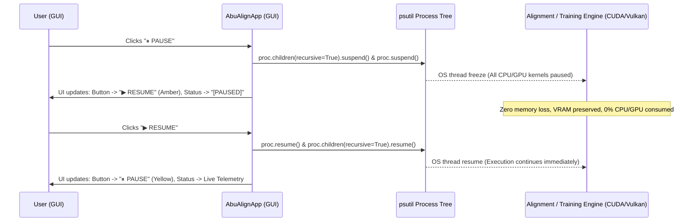

# Implementation Plan - Version v0.0.1.3: Automated Versioning, Visual Telemetry & Universal Pause/Resume

This plan addresses:
1. **Automated Base-10 Version Management (`v0.0.1.3`):** Strict single-digit rollover logic ($0 \to 9$, rolling over into the left digit like an odometer) with automated version bumping and synchronization across all GUI, CLI, engine, launcher, and batch files before each Git commit.
2. **High-Visibility Visual Progress Bar & Stage Indicator:** Fix the dark-mode invisibility issue seen in the user's screenshot by replacing the flat 0-value progress bar with an accented high-contrast progress gauge, stage step indicators (1 to 6), and an embedded percentage readout.
3. **Universal Pause / Resume Engine:** Cross-engine execution freeze and unfreeze supporting all 4 alignment engines (VGGT, VGGT-Omega, ACE0, PyCuSFM) and all 3 training engines (LichtFeld Studio, Nerfstudio Splatfacto, NVIDIA 3DGRUT) using recursive Windows process tree thread suspension via `psutil`.

---

## User Review Required

> [!IMPORTANT]
> **Universal Pause / Resume Mechanism:**
> Process thread suspension (`psutil.Process(pid).suspend()` and `.resume()`) freezes all OS threads and CUDA kernel queues of the running worker and child processes without losing GPU VRAM allocations or state. This works universally across python scripts and compiled C++/Vulkan binaries (like `LichtFeld-Studio.exe`) without needing engine-specific source code modifications.

---

## Proposed Architecture & Changes

### 1. Automated Base-10 Version Management (`version_manager.py`)

#### Base-10 Rollover Specification:
Format: `vMAJOR.MINOR.PATCH.BUILD` (e.g. `v0.0.1.3`)
- Each digit $d \in \{0, 1, 2, 3, 4, 5, 6, 7, 8, 9\}$.
- When `bump()` is called:
  - If `BUILD < 9`: `BUILD += 1`.
  - If `BUILD == 9`: `BUILD = 0`, and `PATCH` increments.
  - If `PATCH == 9`: `PATCH = 0`, and `MINOR` increments.
  - If `MINOR == 9`: `MINOR = 0`, and `MAJOR` increments.
- Examples:
  - `v0.0.0.9` $\to$ `v0.0.1.0`
  - `v0.0.1.2` $\to$ `v0.0.1.3`
  - `v0.0.1.9` $\to$ `v0.0.2.0`
  - `v0.0.9.9` $\to$ `v0.1.0.0`

#### Component: [NEW] `version_manager.py` & `Abu_Align/version_manager.py`
- Stores current canonical version.
- Provides CLI commands:
  - `python version_manager.py --current`
  - `python version_manager.py --bump` (bumps version and automatically updates all files)
  - `python version_manager.py --set 0.0.1.3`
- Updates version constants in:
  - `abu_align_gui.py` (window title, badge, about box, console banner)
  - `align_cli.py` (CLI banner, report headers)
  - `train_engine.py` (banner)
  - `launcher.cs` (app name)
  - Batch scripts (`Abu_Align.bat`, `Abu_Align_and_Train.bat`)
  - Compiles binary `Abu_Align_and_Train.exe` and `Abu_Align_and_Train_v0.0.1.3.exe`

---

### 2. High-Visibility Progress Bar & Stage Step Badges in GUI

#### Why it was not clearly visible in the screenshot:
- In dark mode (`#1e1e2e`), the flat `ttk.Progressbar` with a zero value has no fill and blends into the dark frame.
- There was no border or numeric percentage text inside the idle bar.

#### Redesigned Visual Telemetry Card in `Abu_Align/abu_align_gui.py`:
1. **Stage Step Breadcrumbs:**
   `[1. Scan] ➔ [2. GPU Init] ➔ [3. Preprocess] ➔ [4. 3D Inference] ➔ [5. Tracking & BA] ➔ [6. 3DGS Train]`
   Highlights the active stage in bright accent colors (Blue/Cyan/Green).
2. **High-Contrast Progress Bar:**
   - Crisp 1px neon border (`#3b82f6`).
   - Distinct dark slate trough (`#11111b`).
   - Vibrant gradient fill (`#3b82f6` to `#60a5fa`).
   - Prominent height (18px) with a centered bold percentage label (`0%` when idle, live `XX.X%` when running).
3. **Live Telemetry Strip:**
   - Active Stage text with query number and photo ID.
   - ETA countdown (`⏱ ETA: 1m 45s`).
   - Smart Cache indicator badges (`⚡ Neural Cache Hit`, `⚡ Tracking Cache Hit`).

---

### 3. Universal Pause / Resume Engine

#### Workflow:

#### Files to Modify:
- **`Abu_Align/abu_align_gui.py` & `abu_align_gui.py`:**
  - Add `self.pause_btn` to Action Bar between `ONE-CLICK` / `ALIGNMENT ONLY` and `■ STOP`.
  - State variables: `self.is_paused = False`.
  - Method `self._toggle_pause()`:
    - Suspends process tree if running.
    - Resumes process tree if already paused.
  - Handle `■ STOP` when paused (resumes before killing to prevent zombie processes).

---

## Verification Plan

### Automated & Unit Tests:
1. **Version Rollover Verification:**
   - Test `version_manager.py` with test versions `0.0.0.9 -> 0.0.1.0`, `0.0.1.2 -> 0.0.1.3`, `0.0.1.9 -> 0.0.2.0`, `0.0.9.9 -> 0.1.0.0`.
   - Verify `v0.0.1.3` is written to all files.
2. **Pause / Resume Functionality:**
   - Launch a run on `SEL Copy` with `vggt_omega`.
   - Trigger `⏸ PAUSE` during Stage 5 tracking.
   - Verify in `nvidia-smi` that GPU utilization drops to 0% and VRAM remains intact.
   - Trigger `▶ RESUME`.
   - Verify that tracking picks up at the exact same query frame and finishes successfully.
3. **GUI Visibility Verification:**
   - Launch GUI and verify that the progress bar, stage indicator, and `0%` label are immediately visible in the idle state.

### Git Version Control:
- Bump version to `v0.0.1.3`.
- Commit all changes to `main` with detailed commit logs.
