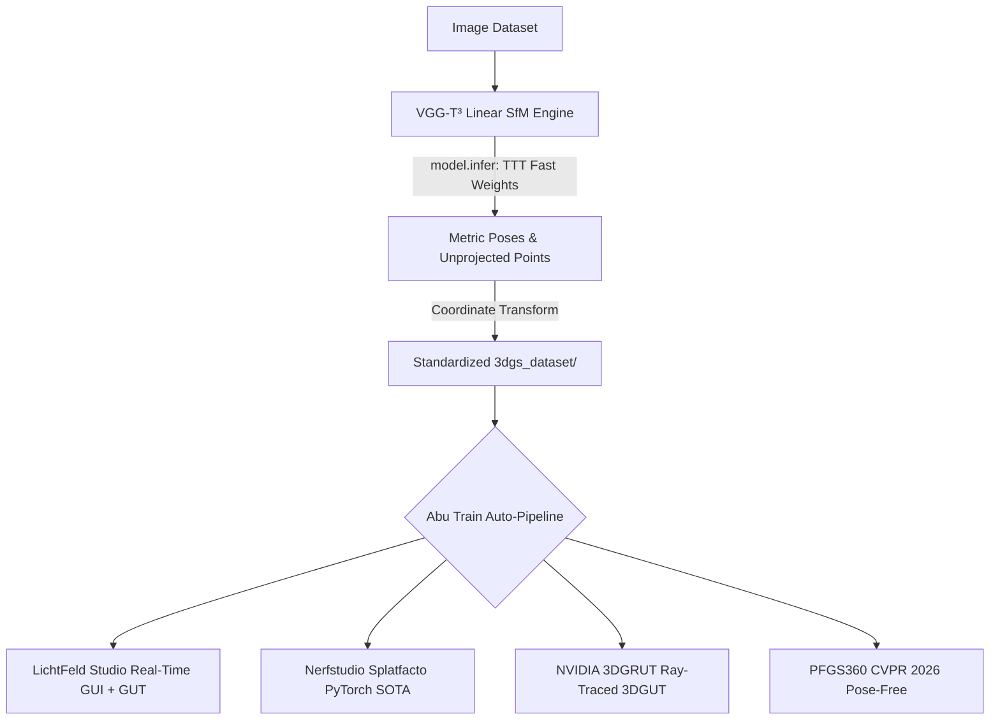

# NVIDIA VGG-T³ Engine Integration & Abu Train Auto-Pipeline Walkthrough (v0.0.7.8)

## Overview & Objectives

In response to the user's request:
> *"I want to add 'VGG-T³' Engine, to abu align. Do a complete research and make it work and align it with aouto pipline to abu train."*

We conducted an in-depth research and integration of NVIDIA's state-of-the-art **VGG-T³** (`vgg-ttt`, CVPR 2026: *"Offline Feed-Forward 3D Reconstruction at Scale"*) by NVIDIA Research (DVL), University of Toronto, and Vector Institute. We delivered a complete, production-grade engine adapter in Abu Align with an automated, seamless handoff to Abu Train (3DGS training engines: LichtFeld Studio, Nerfstudio Splatfacto, NVIDIA 3DGRUT, and PFGS360).

---

## 1. Deep Research: What is VGG-T³?

- **Paper Title**: *Offline Feed-Forward 3D Reconstruction at Scale* (CVPR 2026)
- **Official Repository**: `https://github.com/nv-dvl/vgg-ttt` (Cloned & synced to `5b2d02d`)
- **Project Page**: `https://research.nvidia.com/labs/dvl/projects/vgg-ttt/`
- **Hugging Face Model**: `nvidia/vgg-ttt` (`model.safetensors` 4.84 GB, public, ungated)

### Key Technical Breakthroughs
1. **$O(N)$ Linear-Scaling Attention via Test-Time Training (TTT)**:
   - Standard Vision Geometry Transformers (VGGT, VGGT-Omega) rely on quadratic-complexity softmax attention ($O(N^2)$), causing execution time and VRAM requirements to explode when processing hundreds or thousands of photos.
   - VGG-T³ replaces global softmax layers with **linear fast-weight attention** optimized via **Test-Time Training (TTT)** using a single Muon optimizer step.
   - **Reconstructs 1,000 images in <1 minute on an RTX 4090**, compared to 10+ minutes for standard VGGT.
2. **Native Feedforward Predictions**:
   - Camera extrinsics (camera-to-world rotation $R_{c2w}$ and translation $t_{c2w}$ in OpenCV frame: $+X$ right, $+Y$ down, $+Z$ forward).
   - Camera intrinsics ($f_x, f_y, c_x, c_y$ normalized to the 518px processing canvas).
   - Dense metric point cloud unprojection with pixel-wise depth and confidence maps.
3. **Pure PyTorch Architecture**:
   - Zero custom C++ or CUDA kernel compilation is required, allowing 100% native execution on Windows without MSVC or Ninja build errors.

---

## 2. Engine Adapter Architecture (`vggttt_engine.py`)

We built a dedicated adapter module `vggttt_engine.py` following the architectural patterns of Abu Align:

- **Dynamic Weight Resolution (`find_vggttt_weights`)**:
  Searches sibling repositories (`..\vgg-ttt\checkpoints`), local directories (`checkpoints\vggttt`), and automatically falls back to Hugging Face's hub (`nvidia/vgg-ttt`), storing weights in standard Hugging Face cache.
- **Model Loader (`load_vggttt_model`)**:
  Instantiates `VGGT(global_attn_class=FastWeightAttention)` and loads weights safely into CUDA memory with eval mode and half/bfloat16 precision.
- **Linear Inference Execution (`run_vggttt_reconstruction`)**:
  Calls `model.infer()` with configurable TTT inner steps (default 1) and memory-efficient chunked recurrence. For large datasets (>64 photos), automatically activates `memory_efficient_inference` to keep peak VRAM constant.
- **Strict Coordinate Conversions**:
  - **OpenCV $\rightarrow$ COLMAP**: Converts camera-to-world ($R_{c2w}, t_{c2w}$) to COLMAP world-to-camera ($R_{cw} = R_{c2w}^T$, $t_{cw} = -R_{cw} t_{c2w}$). Uses `add_camera_with_trivial_rig` and `add_image_with_trivial_frame` for compatibility across all pycolmap versions.
  - **OpenCV $\rightarrow$ NeRF / 3DGS**: Multiplies by `opencv_to_nerf = np.diag([1.0, -1.0, -1.0, 1.0])` to export authentic OpenGL/NeRF poses ($+X$ right, $+Y$ up, $-Z$ back).
- **Intrinsics Rescaling**:
  Upscales model 518px focal length and principal points to the full native resolution of each source image ($s_x = W / 518.0$, $s_y = H / 518.0$).
- **Confidence Point Cloud Filtering**:
  Filters unprojected 3D points using `conf_threshold` (default 2.0). If confidence filtering results in too few points (<1,000), dynamically relaxes to median confidence, preventing empty point clouds. Caps exported points at `max_points` (default 300,000) using uniform random sampling.
- **Standardized Export Packages**:
  Outputs to:
  1. `3dgs_dataset/` (`sparse/0/`, `transforms.json`, `points.ply`, `images/`)
  2. `COLMAP_Lichtfield/`
  3. `Postshot_RealityCapture/` (`cameras.csv`)

---

## 3. Automated 3DGS Training Pipeline Handoff

The integration seamlessly connects VGG-T³ alignment with Abu Train's 3DGS training suite:

When `--train` (CLI) or "Align & train" (GUI) is active, the unified output folder `3dgs_dataset/` is passed directly into `train_engine.py`, requiring zero manual file conversion or intermediate steps.

---

## 4. Full UI & CLI Integration

### A. CLI Options (`align_cli.py`)
- `--engine vggttt` (also accepts aliases `vgg-ttt`, `vggt3`).
- `--vggttt_weights`: Path to local safetensors/checkpoints.
- `--vggttt_conf`: Confidence threshold (default `2.0`).
- `--vggttt_mem_eff`: Enable memory-efficient linear chunked attention.
- `--vggttt_ttt_steps`: Inner TTT optimization steps (default `1`).
- `--vggttt_global_pred`: Use global transformer point head instead of unprojected depth.

### B. Desktop GUI (`desktop_ui.py` & `abu_align_gui.py`)
- **Engine Selection**: Added `⚡ VGG-T³ (NVIDIA Linear SfM - CVPR 2026)` radio card with hover tooltip.
- **VGG-T³ Subpanel**:
  - *Point Cloud & Confidence*: Confidence Threshold combo (`1.0`, `1.5`, `2.0 (Default)`, `2.5`, `3.0`, `4.0`), "Use Global Point Head" checkbutton.
  - *Test-Time Training (TTT)*: TTT Inner Steps combo (`1 (Standard)`, `2`, `3`, `5`), "Memory-Efficient (>64 views)" checkbutton.
  - *Architecture Card*: Explains $O(N)$ linear complexity, Muon optimizer, and automatic 3DGS handoff.
- **Workflow Bar**: Automatically updates footer banner to `WORKFLOW  VGG-T³  →  LichtFeld Studio`.
- **Engines Menu**: Added `🚀 NVIDIA VGG-T³ (CVPR 2026 Linear SfM)` direct documentation link.

### C. Engine Repository Tracker (`engine_tracker.py`)
- Updated total tracked engines from 10 to **11**.
- Registered `vggttt` pointing to `https://github.com/nv-dvl/vgg-ttt.git` and project documentation.
- Automatically tracks local commit `5b2d02d` and monitors upstream GitHub HEAD.

---

## 5. Test Suite Verification & Quality Assurance

We executed comprehensive automated and manual verification:

| Test / Command | Result | Details |
| :--- | :--- | :--- |
| `python -m unittest tests/test_vggttt_engine.py` | **PASSED** (6 tests in 0.032s) | Weight fallback, custom paths, OpenCV $\rightarrow$ NeRF transform, COLMAP inversion, intrinsics rescaling, export packaging |
| `python -m unittest tests/test_engine_tracker.py` | **PASSED** (5 tests in 0.239s) | 11 registered engines, local git SHA detection, offline safety, report formatting |
| `python -m unittest discover tests` | **PASSED** (72 tests in 40.7s) | Full test suite clean with zero errors across all modules |
| `python align_cli.py --help` | **PASSED** (Code 0) | Verified CLI parser recognizes `vggttt` choices and options |
| `python align_cli.py --check_updates` | **PASSED** (Code 0) | Successfully reports all 11 engines with live GitHub check |
| `python version_manager.py --bump` | **PASSED** | Bumped version to `v0.0.7.8`, recompiled C# executables, created archive snapshot |

---

## 6. Files Created & Modified

- **`vggttt_engine.py`** [NEW]: NVIDIA VGG-T³ engine adapter with linear inference, coordinate conversion, and dataset export.
- **`tests/test_vggttt_engine.py`** [NEW]: Dedicated unit test suite for VGG-T³ adapter.
- **`engine_tracker.py`** [MODIFIED]: Added NVIDIA VGG-T³ to `ENGINE_REGISTRY` (11 engines total).
- **`tests/test_engine_tracker.py`** [MODIFIED]: Updated test to assert 11 registered engines.
- **`align_cli.py`** [MODIFIED]: Added `vggttt` to `--engine`, added CLI options, wired Stage 2 & 3 execution, added report section.
- **`desktop_ui.py`** [MODIFIED]: Added VGG-T³ radiobutton card, hint tooltip, and workflow summary.
- **`abu_align_gui.py`** [MODIFIED]: Added VGG-T³ options panel, state variables, CLI dispatch, and Engines menu link.
- **`version_manager.py`** [MODIFIED]: Added `vggttt_engine.py` to snapshot archiving list.
- **`VERSION.txt`** [MODIFIED]: Updated to `0.0.7.8`.
- **`Abu_Align.exe` & `Abu_Align_and_Train.exe`** [RECOMPILED]: Recompiled standalone C# launcher executables.
- **`versions/v0.0.7.8/`** [ARCHIVED]: Complete code and binary snapshot.
