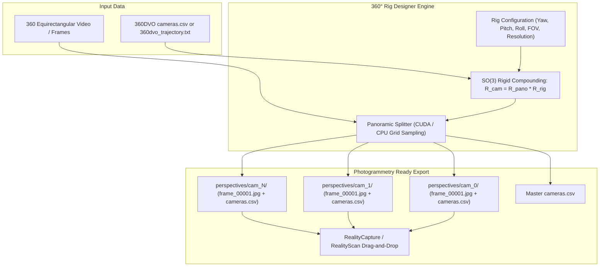

# v0.1.0.2 — 360° Rig Designer: RealityScan Standard cameras.csv Export & 360DVO Trajectory Compounding

## Overview & Outcome
Abu Align & Train **v0.1.0.2** integrates full photogrammetric camera orientation and positioning export adhering to the **RealityScan / RealityCapture standard** within the **360° Rig Designer**, paired with automatic ingestion and 6-DoF compounding of **360DVO** trajectory results:

1. **RealityScan / RealityCapture Standard `cameras.csv` Export**:
   * **Coordinate System & Body Frame**: Strict Z-up world frame, where optical ray forward vector determines orientation:
     * **Nadir Pitch**: $[0^\circ, 180^\circ]$ where $0^\circ$ is Nadir (pointing straight down), $90^\circ$ is horizontal, and $180^\circ$ is Zenith (pointing straight up).
     * **Azimuth Yaw**: $[0^\circ, 360^\circ)$ measured clockwise from North (+Y) to East (+X).
     * **Roll**: $[-180^\circ, 180^\circ]$ rotational angle around the optical viewing ray.
     * **35mm Focal Length**: Canonical sensor-equivalent focal length $f_{35\text{mm}} = f_x \cdot \frac{36.0}{\max(W, H)}$.
     * **Format**: `#name,x,y,alt,yaw,pitch,roll,f_35mm,px_norm,py_norm,k1,k2,k3,k4,t1,t2`
   * **Multi-Tier File Organization**:
     * **Per-Perspective Folders**: When enabled (default), each perspective camera directory (`output_dir/perspectives/<cam_name>/`) contains its own local `cameras.csv` using local relative image names (`frame_00001.jpg`), enabling seamless drag-and-drop into RealityCapture or RealityScan without filename or path remapping errors.
     * **Master Table**: `output_dir/cameras.csv` indexes every single generated pinhole perspective across all virtual rig cameras.
     * **Per-Camera Directory**: `output_dir/cameras_csv/<cam_name>_cameras.csv` isolates each rig angle for modular photogrammetric chunking.

2. **360DVO Trajectory Prior Ingestion & 6-DoF Compounding**:
   * Accepts previous 360DVO alignment outputs (either RealityCapture `cameras.csv` or TUM `360dvo_trajectory.txt`).
   * Rigorously compounds the 6-DoF panorama trajectory pose with virtual rig camera angular offsets in $SO(3)$:
     $$\mathbf{R}_{\text{world}\to\text{cam}} = \mathbf{R}_{\text{world}\to\text{pano}} \cdot \mathbf{R}_{\text{rig\_cam}}$$
     $$\mathbf{t}_{\text{cam}} = \mathbf{t}_{\text{pano}} + \mathbf{R}_{\text{world}\to\text{pano}} \cdot \mathbf{t}_{\text{rig\_cam}}$$
   * Robust multi-mode frame matching supports exact image filename, stem lookup (e.g. `frame_00042`), or sequential index lookup.
   * If no 360DVO trajectory prior is supplied, exports zero-centered poses reflecting the true virtual rig orientations.

3. **360DVO Engine Automatic CSV Generation**:
   * Updated `360dvo_engine.py` and `dvo360_engine.py` to automatically transform TUM trajectories (`360dvo_trajectory.txt`) into RealityCapture `cameras.csv` upon completion of WSL2 or fallback tracking.
   * Preserved byte-for-byte SHA256 parity (`6BDF2B5D452AA84103B08009B2FB6177F6F02C651E8069670247B9A23ED937F9`).

4. **Interactive GUI & Workflow Controls**:
   * **Source Tab**: Added `360DVO Prior:` row with interactive entry, `[🔍 Auto-detect]`, `[Browse...]`, and live badge displaying the count of matched camera poses.
   * **Export Tab**: Added toggles for `Export cameras.csv (RealityScan standard)` and `Folder per perspective (with cameras.csv)`.
   * **CLI Options**: Added `--no-rc-csv`, `--flat-images`, and `--dvo-trajectory` flags to `panoramic_splitter.py`.

---

## Architectural & Compounding Flow

---

## Verification & Automated Test Results

* **Dedicated Test Suite**: `tests/test_rig_cameras_csv.py` (10 tests, 0.145s)
  * `test_basis_orthonormality`: Verified basis vectors are strictly orthonormal for arbitrary angles.
  * `test_basis_cardinal_directions`: Verified Front, Right, Back, Left, Zenith, Nadir optical directions.
  * `test_rc_axes_to_euler_roundtrip`: 75-angle randomized stress test with $< 10^{-4}$ deg error.
  * `test_nadir_zenith_pitch`: Verified Nadir = $0^\circ$, Zenith = $180^\circ$, Horizontal = $90^\circ$.
  * `test_load_dvo_trajectory_csv`: Verified parsing of RealityCapture `cameras.csv` tables.
  * `test_load_dvo_trajectory_tum`: Verified parsing of TUM format trajectories.
  * `test_compound_pose_identity_pano`: Verified rig angular offsets are preserved at identity trajectory.
  * `test_compound_pose_rotated_pano`: Verified proper rotation group multiplication under non-trivial trajectory poses.
  * `test_split_dataset_with_rc_csv_subfolders`: Verified generation of per-perspective local `cameras.csv` and master `cameras.csv`.
  * `test_split_dataset_flat_layout`: Verified backward compatibility with flat layout.
* **Full Regression Suite**: 133 tests passed in 60.789s (0 failures, 0 regressions).
* **Upstream Cleanliness**:
  * `vgg-ttt/`: 100% clean
  * `vggt-omega/`: 100% clean
  * WSL `/home/ahmad/360DVO/`: 100% clean
