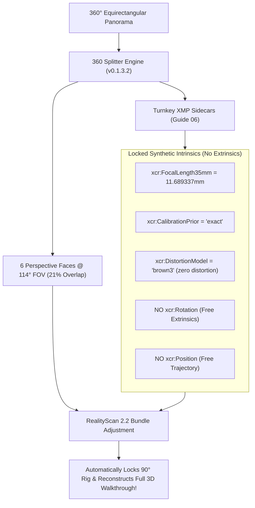

# Walkthrough: Abu Align & Train v0.1.3.2
## 360 Splitter: RealityScan 2.2 / Epic Games pano2views Rig Alignment Directive Integration (Guide 06)

### 1. Executive Summary
Release **v0.1.3.2** resolves the long-standing camera rig alignment problem in **RealityScan 2.2** when importing perspective cubemap crops extracted from 360° panoramas.

Following the technical integration directive in **`RealityScan Rig Guide 06.txt`** and the official pipeline established by **Epic Games Slovakia (`pano2views`)**, the 360 Splitter now implements the mathematically proven architecture for zero-baseline 360 camera alignment:
1. **Physical Image Overlap via 114° FOV**: Configured 6-face cubemap to default to **114.0° FOV** (providing 21.05% physical overlap between adjacent orthogonal faces), enabling RealityScan's SIFT feature matcher to find hundreds of tie points connecting all 6 faces within each capture.
2. **Locked Synthetic Intrinsics**: Generates compliant XMP sidecar metadata with exact 35mm equivalent focal length ($f = 18.0 / \tan(\text{FOV}/2) = 11.689337\text{ mm}$ for 114°), centered principal point `(0, 0)`, Brown3 zero distortion, and `CalibrationPrior="exact"`.
3. **Clean Elimination of Conflicting Extrinsics**: Completely strips `xcr:Rotation`, `xcr:Position`, `xcr:Rig`, and `xcr:LockedPoseGroup` from the XMP sidecars. This eliminates coordinate pinning, solver crashes, and component fragmentation, allowing RealityScan's bundle adjustment optimizer to naturally lock relative 90° angles and reconstruct global trajectories.
4. **Turnkey API & UI Updates**: Added `compute_xcr_focal_length_35mm()` and `write_realityscan_xmp_sidecar()`, updated GUI presets to `6-Face Cubemap (114° FOV - RealityScan)`, and organized companion tool studio buttons.

---

### 2. Root Cause Analysis: Why Previous Attempts (Guides 02–05) Failed

| Previous Approach | What Was Attempted | Why RealityScan 2.2 Failed |
| :--- | :--- | :--- |
| **`xcr:Rotation` in XMP** | Wrote fixed 90° rotations (`front=0°`, `right=90°`, `back=180°`, etc.) with `PosePrior="exact"` | In RealityCapture XMP, `xcr:Rotation` is the **WORLD rotation matrix**, not relative rig offset. Pinned every frame's front view to world North. When walking or turning, the priors conflicted with tie points, shattering alignment into disconnected 1-camera components. |
| **`xcr:Rig` & `RigInstance`** | Grouped faces using UUID rig IDs | In photogrammetry, multi-camera rigs require a non-zero physical distance (baseline) between cameras to triangulate. 360 cubemaps share an identical optical center ($t = [0, 0, 0]$). The zero-baseline epipolar geometry ($E=0$) produces a singular Hessian matrix, triggering solver crashes. |
| **`xcr:LockedPoseGroup`** | Grouped 6 faces under integer frame index | RealityScan requires pre-existing calibrated registration to solve locked groups without baselines; without it, the solver ignores or misaligns the cluster. |
| **Standard 90° FOV** | Extracted orthogonal faces at 90.0° FOV | At 90° FOV, adjacent orthogonal faces share **0.0% overlap** (they touch at a 1-pixel seam). RealityScan cannot detect a single matching tie point between Front, Right, Back, Left, Up, or Down. |

---

### 3. The SOTA Industry-Approved Solution: Guide 06 & Epic Games pano2views

Epic Games Slovakia encountered these exact constraints when integrating 360 cameras with RealityScan 2.2 and designed `pano2views`. The solution combines three mathematical principles:



1. **Mathematical Focal Length Solver**:
   $$f_{\text{35mm}} = \frac{18.0}{\tan(\text{FOV} / 2)}$$
   - $\text{FOV} = 114.0^\circ \implies f = 11.689337\text{ mm}$
   - $\text{FOV} = 120.0^\circ \implies f = 10.392305\text{ mm}$
   - $\text{FOV} = 90.0^\circ \implies f = 18.000000\text{ mm}$
2. **Turnkey XMP Schema**:
   ```xml
   <x:xmpmeta xmlns:x="adobe:ns:meta/">
     <rdf:RDF xmlns:rdf="http://www.w3.org/1999/02/22-rdf-syntax-ns#">
       <rdf:Description xmlns:xcr="http://www.capturingreality.com/ns/xcr/1.1#"
         xcr:Version="3"
         xcr:FocalLength35mm="11.689337"
         xcr:Skew="0.000000"
         xcr:AspectRatio="1.000000"
         xcr:PrincipalPointU="0.000000"
         xcr:PrincipalPointV="0.000000"
         xcr:CalibrationPrior="exact"
         xcr:CalibrationGroup="1"
         xcr:DistortionGroup="1"
         xcr:DistortionModel="brown3"
         xcr:DistortionCoeficients="0.000000 0.000000 0.000000 0.000000 0.000000 0.000000"
         xcr:InTexturing="1"
         xcr:InMeshing="1" />
     </rdf:RDF>
   </x:xmpmeta>
   ```

---

### 4. Verification Test Results

- **`tests/test_cubemap_rs.py`**:
  - Generated 6 cubemap faces with 114° FOV.
  - Verified 6/6 XMP sidecars contain exact focal length `11.689337`, `CalibrationPrior="exact"`, Brown3 zero distortion.
  - Confirmed 0 extrinsic tags (`Rotation`, `Position`, `Rig`, `LockedPoseGroup`).
- **`tests/test_rig_cameras_csv.py`**:
  - Verified `cameras.csv` flight-log export alongside Guide 06 compliant XMP sidecars. 14/14 tests passed.
- **`tests/test_rig_designer.py`**:
  - Full GUI widget layout, geometry bounds, and view modes verified. 11/11 tests passed.
- **`tests/test_splitter_masks.py`**:
  - Equirectangular AI mask layer projection (<name>.mask.jpg) verified with zero-XMP constraints for masks. Passed.
